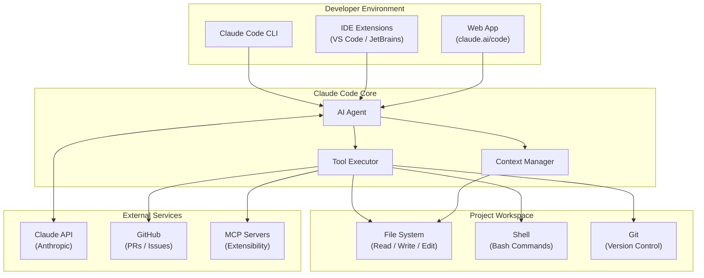

# Claude

A project for exploring and building with [Claude Code](https://claude.ai/code) — Anthropic's AI-powered coding assistant.

## System Architecture



## Project Structure

```
claude/
├── CLAUDE.md        # Instructions for Claude Code instances
└── README.md        # Project documentation (this file)
```

> As the project grows, new directories and files will be added here.

## Setup

### Prerequisites

- [Git](https://git-scm.com/) installed
- A [GitHub](https://github.com/) account
- [Claude Code](https://claude.ai/code) access (CLI, IDE extension, or web)

### Getting Started

1. **Clone the repository**

   ```bash
   git clone https://github.com/prateek20s/Claude.git
   cd Claude
   ```

2. **Start Claude Code**

   Using the CLI:
   ```bash
   claude
   ```

   Or open the project in your IDE with the Claude Code extension, or use the [web app](https://claude.ai/code).

3. **Start building**

   Claude Code will read `CLAUDE.md` for project context automatically. Ask it to scaffold features, write code, run tests, or manage git workflows.

## Usage

| Action | Command |
|---|---|
| Start Claude Code CLI | `claude` |
| Run a one-shot prompt | `claude -p "your prompt"` |
| Resume last session | `claude --continue` |
| Get help | `/help` inside a session |

## Contributing

1. Create a feature branch from `main`
2. Make your changes
3. Push and open a pull request

## License

This project is private. All rights reserved.
